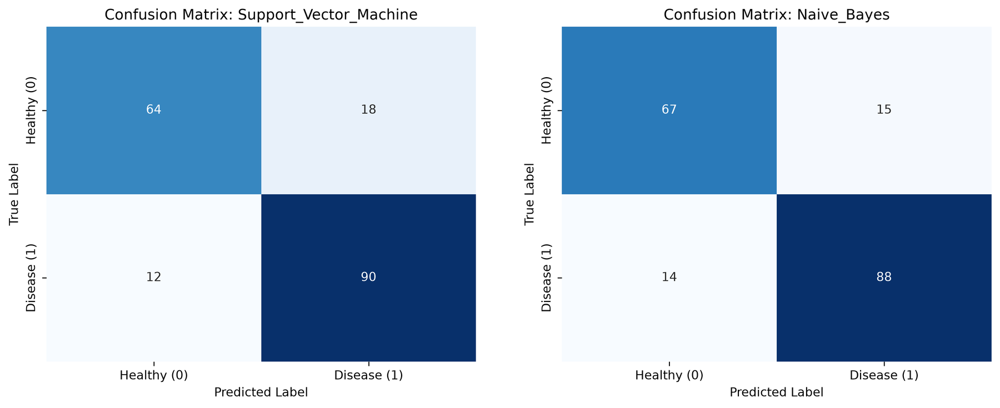
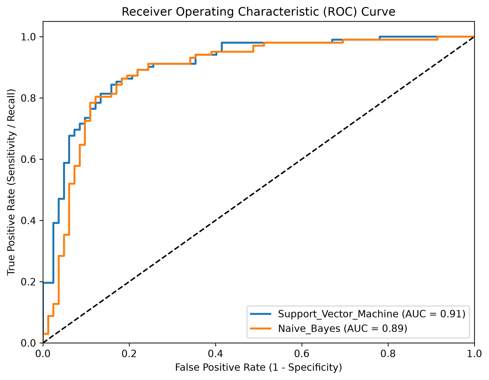
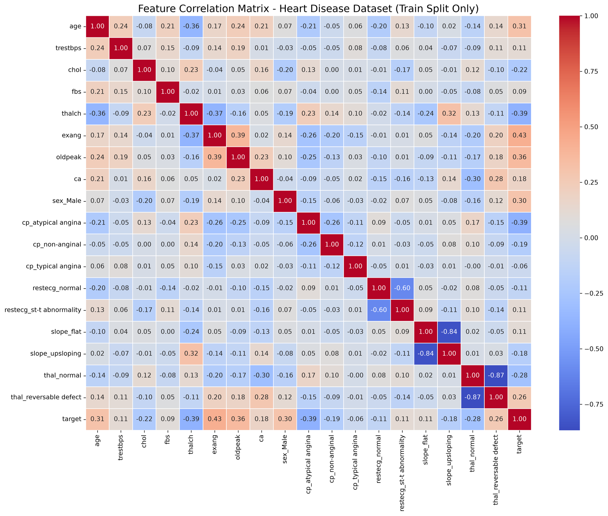

# Heart Disease Classification — SVM vs. Naive Bayes

An end-to-end, leakage-free classification pipeline that compares a linear Support Vector Machine with Gaussian Naive Bayes for detecting heart disease from routine clinical measurements.



`Python 3.9+` · `scikit-learn` · Applied ML / course project · Complete

## At a glance

| | |
|---|---|
| **Task** | Binary classification — heart disease present vs. absent |
| **Data** | UCI Heart Disease, 920 patient records, 13 clinical features |
| **Split** | 80/20 stratified hold-out — 736 train / 184 test |
| **Models** | Linear SVM (Platt-scaled probabilities) and Gaussian Naive Bayes |
| **Results** | SVM **83.7%** accuracy, **AUC 0.91**; Naive Bayes **84.2%**, **AUC 0.89** |
| **Verification** | Full 7-stage pipeline executed end-to-end; all figures in this README are its output |
| **Role** | Solo — preprocessing design, modelling, evaluation, documentation |

## Overview

The pipeline answers a practical comparison question: on a small, mixed-type clinical dataset, does a margin-based classifier outperform a probabilistic baseline once both are given the same leakage-free preprocessing?

The important engineering property is ordering. The data is split **before** any statistic is computed; imputation medians/modes, one-hot categories, scaler parameters and correlation-based feature screening are all derived from the training split only, then applied to test. This is enforced through explicit on-disk splits (`X_train.csv`, `X_test.csv`) rather than an opaque in-memory pipeline, which keeps every intermediate artefact inspectable for grading and review.

## Results

Measured on the untouched 184-record test set (`random_state=42`):

| Model | Accuracy | Precision (disease) | Recall (disease) | F1 (disease) | ROC-AUC |
|---|---:|---:|---:|---:|---:|
| Linear SVM | 0.8370 | 0.83 | 0.88 | 0.86 | **0.91** |
| Gaussian Naive Bayes | **0.8424** | 0.85 | 0.86 | 0.86 | 0.89 |

The accuracy difference is **one patient out of 184**, so it is not meaningful. The SVM's clearer advantage is ranking quality (AUC 0.91 vs. 0.89), which matters if the score is used to prioritise further testing rather than to make a hard call. Both models favour recall on the disease class (0.88 / 0.86), the safer error profile for a screening task.



**Error breakdown (test set):**

| Model | True negatives | False positives | False negatives | True positives |
|---|---:|---:|---:|---:|
| SVM | 64 | 18 | 12 | 90 |
| Naive Bayes | 67 | 15 | 14 | 88 |

## Method

```text
data/raw/dataset.csv
   │  (copied, never mutated)
   ▼
Step 1  Stratified 80/20 split → median/mode imputation fitted on train
   ▼
Step 2  One-hot encoding, drop_first=True
   ▼
Step 3  Z-score scaling of continuous measurements only
   ▼
Step 4  Correlation screening on train → heatmap
   ▼
Step 5  SVM + Naive Bayes fit, serialized to models/
   ▼
Step 6  Confusion matrices + ROC/AUC on held-out test
```

| Stage | Script | Key decision |
|---|---|---|
| 0. Isolation | `main.py` | Raw CSV copied with `shutil.copy2`; original never modified |
| 1. Clean & split | `src/data_cleaning.py` | Split first, then impute with train-only median/mode |
| 2. Encode | `src/categorical_encoding.py` | `drop_first=True` avoids the dummy-variable trap |
| 3. Scale | `src/feature_scaling.py` | Scales only `age`, `trestbps`, `chol`, `thalch`, `oldpeak` |
| 4. Select | `src/feature_selection.py` | \|r\| ≥ 0.05 against target, computed on train only |
| 5. Train | `src/model_training.py` | `SVC(kernel="linear", probability=True)`, `GaussianNB` |
| 6. Evaluate | `src/final_evaluation.py` | 300 DPI confusion matrices and ROC curves |

The interactive pause before each stage is intentional: it makes the pipeline usable as a live demonstration without changing its data flow. Piping newlines (`yes '' | python main.py`) runs it unattended.



## Engineering notes

- **Split before transform.** The most consequential choice. Computing medians, encodings or scaler statistics on the full dataset inflates test accuracy and is the classic leakage failure in student ML projects.
- **Different score APIs, one ROC path.** Naive Bayes exposes `predict_proba`; the SVM exposes `decision_function`. Evaluation detects the available method at runtime so both models are scored consistently without special-casing names.
- **Scaling whitelist, not blanket scaling.** Standardising binary one-hot columns would destroy their interpretation and distort distances.

## Limitations

- **Small sample, single split.** 920 patients and one 80/20 split give wide confidence intervals; no cross-validation or repeated splits are reported. The 0.5-point accuracy gap is within noise.
- **Univariate correlation screening.** It is computed on the training split (correct), but it can discard features that are only useful in combination. No ablation compares the screened model against the full feature set.
- **No probability calibration study.** `probability=True` uses Platt scaling internally; calibration curves and Brier scores are not reported.
- **Dataset provenance.** Results depend on the specific combined UCI Heart Disease file in `data/raw`; the repository does not pin a checksum.
- **Not a clinical claim.** This is an educational baseline, not a validated screening tool.

## Screenshots

| Figure | What it shows |
|---|---|
|  | Side-by-side test-set confusion matrices |
|  | ROC curves; SVM AUC 0.91, NB AUC 0.89 |
|  | Train-only feature/target correlations |

A full interactive demo is available as [`assets/Demo.gif`](assets/Demo.gif).

## Repository structure

```text
heart-disease-prediction/
├── main.py                       # Orchestrator with pause-before-step control
├── src/
│   ├── data_cleaning.py          # Split, then train-only imputation
│   ├── categorical_encoding.py   # One-hot encoding
│   ├── feature_scaling.py        # Continuous-feature standardisation
│   ├── feature_selection.py      # Correlation screening + heatmap
│   ├── model_training.py         # SVM and Naive Bayes
│   └── final_evaluation.py       # Confusion matrices and ROC
├── data/raw/dataset.csv          # Untouched input
├── data/processed/               # Generated splits (git-ignored)
├── models/                       # Serialized .pkl models (git-ignored)
├── reports/figures/              # Generated figures (git-ignored)
├── assets/                       # Committed figures used in this README
└── requirements.txt
```

## Getting started

```bash
git clone https://github.com/amir-khoshdel-louyeh/heart-disease-prediction.git
cd heart-disease-prediction
python -m venv .venv
source .venv/bin/activate        # Windows: .venv\Scripts\activate
pip install -r requirements.txt
python main.py
```

Press **Enter** at each prompt to advance, or run the whole pipeline unattended:

```bash
yes '' | python main.py
```

**Generated artefacts:** `models/Support_Vector_Machine.pkl`, `models/Naive_Bayes.pkl`, `reports/figures/confusion_matrices.png`, `reports/figures/roc_curve.png`, `reports/figures/correlation_heatmap.png`.

## Reproducibility

- `random_state=42`, `test_size=0.2`, `stratify=y`.
- Feature-selection threshold: |r| = 0.05, train split only.
- Environment used for these numbers: Python 3.14, scikit-learn 1.9.1, seaborn 0.13.2.
- Re-running overwrites `data/processed`, `models` and `reports`; the raw dataset is never touched.

## Disclaimer

Educational and research use only. Not a medical device and not suitable for clinical diagnosis or treatment decisions.

## Author

**Amir Khoshdel Louyeh**
[GitHub](https://github.com/amir-khoshdel-louyeh) · [LinkedIn](https://www.linkedin.com/in/amir-khoshdel-louyeh)
